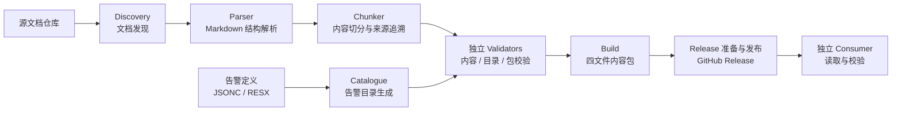

# ANCA 文档与告警内容流水线（墨尔本大学 IT Project 毕业设计）

> 墨尔本大学 COMP30022 IT Project（计算机专业 Capstone），2026 年第二学期，五人团队项目。
> 客户：ANCA Motion。
>
> **说明：** 项目代码和客户提供的资料按客户与学校的保密要求存放在团队私有仓库中，本仓库只包含项目介绍，不含源代码和客户资料。如需了解实现细节，可在面试中演示或说明。

## 项目简介

客户需要把大量产品技术文档（Markdown）和设备告警定义整理成可检索、可追溯的结构化内容包，供下游的 RAG（检索增强生成）问答助手使用。

我们团队用 Python 搭建了一条端到端内容流水线：从源仓库获取文档，解析结构、切分内容块、生成告警目录，经过多道独立校验后打包成固定格式的内容包，再发布到 GitHub Release，由独立的读取端校验并接收。

整条流程的设计原则是 **可追溯、可复现、出错不静默**：

- 每个内容块都能回溯到原文件和具体行号，并带 SHA-256 哈希。
- 构建结果是确定性的。输入相同，输出的字节完全相同。
- 无法识别的结构会显式上报为问题，不会被静默误解析；校验不通过的候选包不会被发布。

## 系统架构

内容包固定为四个文件：`documents.jsonl`、`catalogue.jsonl`、`manifest.json`、`validation-report.json`。manifest 记录每个文件实际字节的大小和 SHA-256。

## 项目成果

- 完整批处理：73 篇 Markdown 文档生成 366 条文档记录、11 条告警目录记录和 366 条受众映射，本地全部检查通过。
- 约 13,000 行 Python 代码，40 个测试模块，约 450 个测试用例。
- 用 GitHub Actions 在 Ubuntu 和 Windows 上双平台运行代码质量检查（Ruff 格式与 lint、mypy strict 类型检查、pytest）。
- Release 发布端和读取端实现了有限次数重试、资产精确校验和版本冲突拒绝。

## 技术栈

| 类别 | 技术 |
| --- | --- |
| 语言与环境 | Python 3.13、uv（锁定依赖，保证跨平台环境一致） |
| 代码质量 | Ruff、mypy（strict 模式）、pytest |
| CI/CD | GitHub Actions（Ubuntu 24.04 / Windows 2025 双平台） |
| 发布 | GitHub Release、GitHub App 权限范围控制 |
| 协作 | Git Flow（feature → develop → main）、PR 互审、Jira、Confluence |

## 我的职责（Xiaoqi Jiang / Yuki）

### 开发：Markdown Parser 与文档发现模块（KAN-64 / KAN-70）

我负责流水线的第一个处理环节：

- **Markdown 块解析器（`mdparser`）：** 无第三方依赖，逐行扫描 Markdown，把文档切分为标题、段落、代码块、表格、列表、提示框（`> [!NOTE]` 等）和图片等结构化块。每个块记录源文件行号范围、原始 Markdown 和所在的标题层级路径。
- **未知结构显式上报：** 未闭合的代码围栏、普通引用块等无法建模的结构输出为 `unknown` 块，并写入文档的问题列表，避免静默误解析。
- **文档发现与批量解析：** 按 include/exclude 规则（自己实现的 glob 匹配）确定要处理的文件，再批量读取解析。单篇文档失败只影响这一篇，其余文档照常输出结果。
- **防止文件被替换的安全检查：** 发现文件和读取文件之间存在时间差。读取前和打开后都会核对文件身份（设备号/inode），防止路径在这段时间里被替换，例如被换成指向文档根目录外的符号链接。不匹配的文件单独报 `FILE_UNREADABLE`。机器相关的信息（绝对路径、inode）不会写进任何输出结果。
- **测试：** 为 Parser 编写了约 100 个测试用例，包括边界情况测试、发现与批量解析测试和基于真实文档的 fixture 回归测试。
- 接入团队统一的 `PipelineIssue` 问题类型，通过 CI 代码质量检查和 PR 评审后合并。

### Sprint 文档与质量保证

- **Sprint 1：** 文档初审；整理 User Stories 和 MoSCoW 优先级，并标注其历史适用范围。
- **Sprint 2：** 负责架构 4+1 视图中的 Scenarios 视图，说明结构与安全相关需求的实际能力和限制。
- **Sprint 3：** 编写 Parser and Discovery 设计文档；维护开发决策登记（Development Decision Register），只记录真实发生的接口、范围和变更决定。
- **Sprint 4：** 负责文档保真与来源追溯验证，从原文逐项核对到最终记录（标题层级、列表、表格、代码、WARNING 等）；维护缺陷登记表（Defect Register），记录复现步骤、负责人、修复和回归证据以及残留风险；参与 Sprint 4 Review。
- 交叉评审：评审 Shared Contracts、Chunker and Provenance、Consumer Readiness 等队友负责的模块和文档。

## 我的收获

- 在多人协作中按 feature → develop → main 的分支流程开发，经历 CI 检查和代码评审。
- 实践了把可追溯性和确定性作为数据管道的核心质量要求。
- 理解了检查时刻与使用时刻之间的竞态（TOCTOU）问题，并在实际代码中做了防御。
- 学会区分“本地测试通过”和“生产验收通过”，在文档中准确陈述验证范围。
